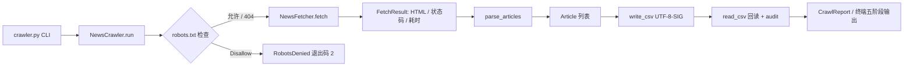
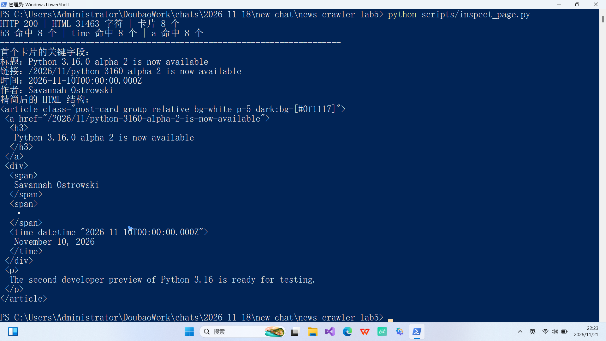
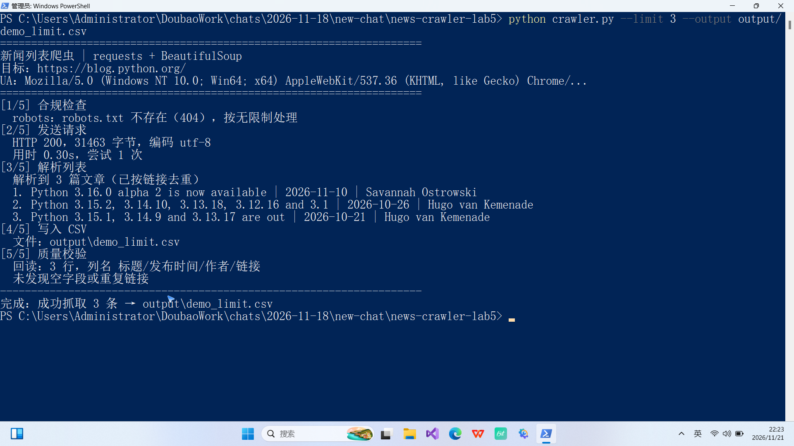
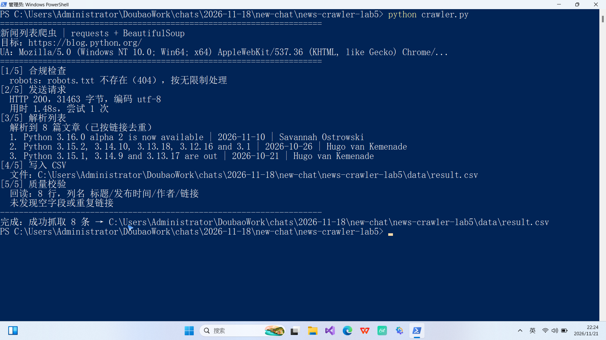
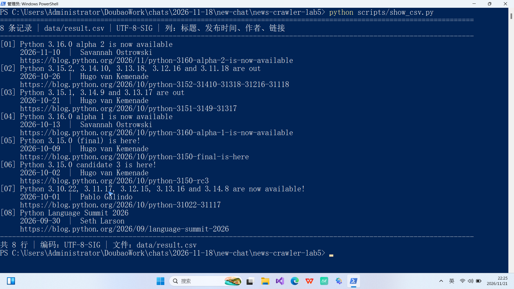
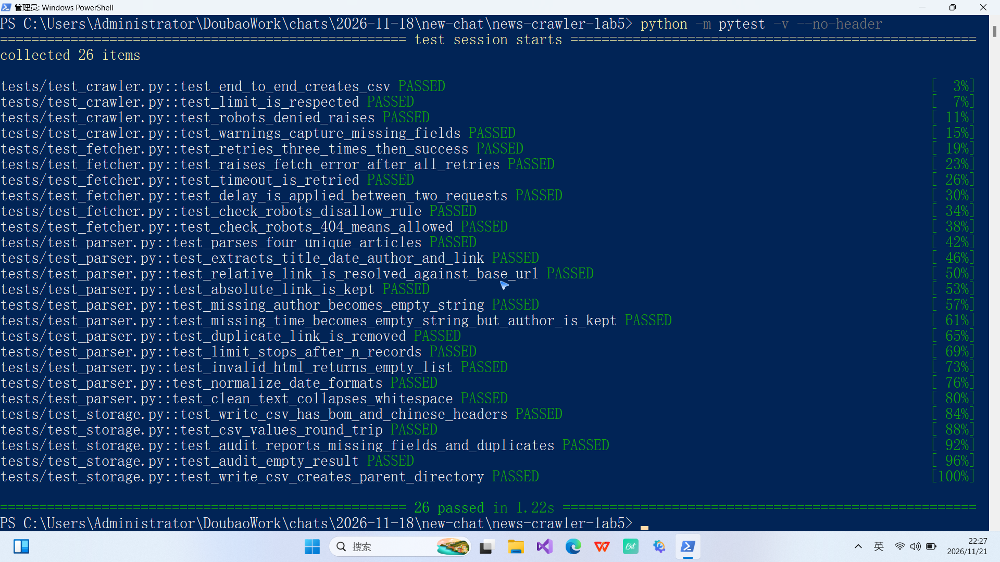
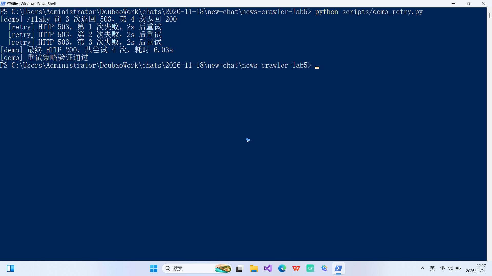
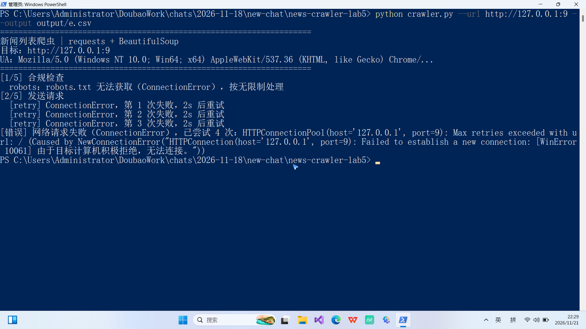
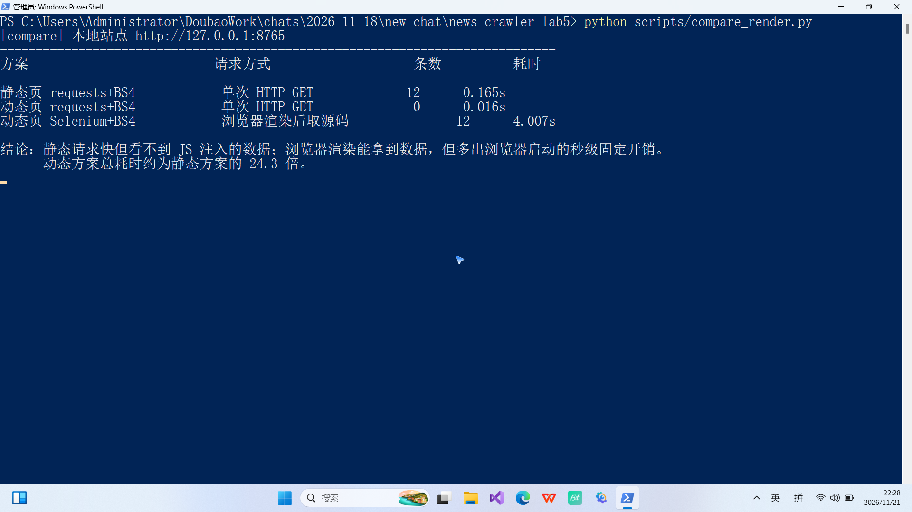

# 从一个列表页到一套可复现的爬虫：requests + BeautifulSoup 实验复盘

仓库地址：<https://github.com/Hanna2126/news-crawler-lab5>

这次实验的目标很具体：抓一个公开静态列表页，提取**标题、发布时间、作者、链接**，写进 UTF-8 CSV；同时满足 UA、2 秒间隔、3 次重试、字段缺失容错，最后重构成 `NewsCrawler`。听上去像一个“几十行就能写完”的任务，真正做起来，难点不在 `requests.get`，而在**怎么证明它每次都能按同样的规则跑完**。

这篇文章按实际开发顺序复盘：需求边界、结构化 Prompt、架构、关键代码、真实运行、踩坑和动态渲染对比。

## 一、先把需求写成可验收的条件

指导书给了四条硬约束，我把它们翻译成可检查的验收项：

| 约束 | 实现 | 怎么验证 |
|---|---|---|
| UA 伪装 | Chrome UA + `CrawlerLab/1.0` 联系方式 | 终端打印 UA 前 88 字符 |
| 间隔不低于 2 秒 | `time.monotonic` 记录上次请求结束时间 | 单测断言 sleep ≥ 1.9 秒 |
| 超时重试 3 次 | 首次 + 3 次重试，最多 4 次尝试 | 本地 503×3 后 200 的演示 |
| 字段缺失填空字符串 | 解析层返回 `""`，CSV 原样写入 | fixture 里放缺作者、缺时间的卡片 |
| UTF-8 CSV | `utf-8-sig`，固定四列 | 回读行数与列名 |
| 合规 | 先读 robots.txt | 404 放行、Disallow 退出码 2 |

这里有一个容易混淆的点：**“能抓到”不等于“可以抓”**。robots.txt 返回 404 只表示站点没有提供规则文件，按 RFC 9309 可以视为不限制；它不等于站点授权你任意高频抓取。所以程序仍然只请求一个公开列表页，不抓正文、不抓图片、不并发翻页。

目标站选的是 `https://blog.python.org/`，原因是它是静态 HTML、结构稳定、字段齐全，而且内容公开。实测 HTTP 200、31463 个字符、8 个 `article.post-card`，标题在 `h3`、时间在 `time[datetime]`、作者在 meta 行的首个 `span`。

## 二、Vibe Coding：把“写个爬虫”拆成四轮

如果只给 AI 一句“帮我写个爬虫”，大概率会得到一段把所有逻辑塞进 `main()` 的代码：没有 UA、没有重试、解析失败就 `IndexError`。这次按指导书的要求，把任务说明拆成四轮，每轮只生成一个能独立验证的最小单元。

1. **意图定义**：角色、目标、约束、验收标准一次写清。
2. **最小请求**：只发 GET，打印状态码、HTML 长度、编码。
3. **最小解析**：只解析卡片，打印前 3 条，确认选择器命中。
4. **持久化与重构**：写 CSV、回读校验，再把函数收进 `NewsCrawler`。

实际使用的 Prompt 骨架：

```text
角色：你是一名熟悉 requests 与 BeautifulSoup 的 Python 爬虫工程师。
目标：抓取一个公开静态列表页，提取标题、发布时间、作者、链接，
      写入 UTF-8 CSV，终端打印成功条数。
约束：1) 使用带 Chrome 标识的 User-Agent；
      2) 同一会话连续请求间隔不低于 2 秒；
      3) 超时 15 秒，失败最多重试 3 次；
      4) 任一字段缺失填空字符串，不能让程序崩溃；
      5) 先检查 robots.txt；不抓正文，不并发，不绕验证码。
验收：HTTP 200；至少解析 8 条；四列齐全；重复链接为 0；
      第二次运行结果一致；pytest 全部通过。
分步：第一步只发请求并打印状态码与 HTML 长度；
      第二步只解析并打印前 3 条；第三步写 CSV 并回读校验。
```

最关键的不是“角色”这句话，而是**约束和验收成对出现**。比如“2 秒间隔”必须能写成测试断言，“缺字段留空”必须能在 CSV 里看到空列。否则 Prompt 只是一份愿望清单。

## 三、架构：五阶段，每层都能单独测



模块职责：

| 模块 | 职责 |
|---|---|
| `src/config.py` | URL、UA、列名、默认参数 |
| `src/fetcher.py` | robots、GET、限速、重试 |
| `src/parser.py` | 卡片解析、日期归一化、去重 |
| `src/storage.py` | DataFrame、CSV 写入、回读审计 |
| `src/crawler.py` | `NewsCrawler` 五阶段编排 |
| `crawler.py` | argparse、异常收敛、退出码 |

这样拆的好处是测试不需要联网：解析层喂 fixture HTML，请求层注入假 `session`，编排层注入假 `fetcher` 和假 `robots_checker`。

## 四、关键代码

### 4.1 限速与重试

```python
def _respect_delay(self) -> None:
    if self._last_request_at is None or self.delay <= 0:
        return
    remaining = self.delay - (time.monotonic() - self._last_request_at)
    if remaining > 0:
        self.sleep_fn(round(remaining, 2))

while attempts <= self.retries:
    self._respect_delay()
    attempts += 1
    response = self.session.get(url, headers=self.headers, timeout=self.timeout)
    self._last_request_at = time.monotonic()
    if response.status_code in RETRY_STATUS:
        if attempts <= self.retries:
            print(f"  [retry] HTTP {response.status_code}，第 {attempts} 次失败")
            continue
        raise FetchError(f"HTTP {response.status_code}，重试后仍失败")
```

`retries=3` 表示首次失败后最多再试 3 次，总尝试上限是 4 次。测试里专门验证了“503×3 后成功”和“500 耗尽抛错”两条路径。

另一个细节是编码。`requests` 在响应头没有 charset 时会退到 ISO-8859-1，中文会乱码；这里在编码为空或为 `iso-8859-1` 时改用 `apparent_encoding`，目标页最终得到 `utf-8`。

### 4.2 解析与容错

```python
cards = soup.select("article.post-card") or soup.select("article")
heading = card.select_one("h3") or card.select_one("h2")
link_tag = heading.find_parent("a") if heading else None
if link_tag is None:
    link_tag = card.select_one("a[href]")
link = urljoin(base_url, link_tag.get("href", "")) if link_tag else ""

time_tag = card.select_one("time")
published = normalize_date(time_tag.get("datetime")) if time_tag else ""

meta = time_tag.parent if time_tag else card.select_one(".meta")
author = ""
for span in meta.select("span") if meta else []:
    candidate = clean_text(span.get_text(" ", strip=True))
    if candidate and candidate not in SEPARATORS:
        author = candidate
        break
```

日期统一成 `YYYY-MM-DD`：先正则抓 `YYYY-MM-DD`，再尝试英文月份、斜杠日期和中文日期；都失败就保留原文。相对链接用 `urljoin` 补全，空标题/空链接跳过，重复链接按首次出现保留。

这里有一个真实的调试点：fixture 的第 4 条没有 `<time>`，最初的实现只从 `time.parent` 找作者，作者就被吞成空字符串。后来改成“有 time 用 `time.parent`，没有 time 退 `.meta`，再没有退第一个 `div`”，用例才通过。字段容错不是多写几个 `try`，而是每一层都留回退路径。

### 4.3 CSV：写入和回读要使用同一套约定

```python
build_frame(articles).to_csv(
    path, index=False, encoding="utf-8-sig", lineterminator="\n"
)

pd.read_csv(path, encoding="utf-8-sig", dtype=str, keep_default_na=False)
```

`utf-8-sig` 是为了 Excel 双击打开不乱码；`lineterminator="\n"` 避免 Windows 下多出空行。回读时 `dtype=str` + `keep_default_na=False` 很关键：pandas 默认会把空列读成 `NaN`，再把整列推断成 float，审计就会冒出“NaN 不是空字符串”的假告警。

### 4.4 重构成 NewsCrawler

重构前是两个平铺函数：`fetch_html(url)`、`parse_html(html)`，参数靠全局变量，测试靠 monkeypatch。重构后把 URL、输出路径、限速、重试、超时、limit 和依赖对象都收进构造参数，`run()` 只做五阶段编排。

| 维度 | 重构前 | 重构后 |
|---|---|---|
| 结构 | 函数平铺 | 五阶段收进一个类 |
| 参数 | 写死或全局 | 构造参数 + config 默认值 |
| 测试 | monkeypatch 模块变量 | 注入假 fetcher / 假 robots |
| 状态 | 限速时间无处保存 | 实例保存 `_last_request_at` |
| 扩展 | 换站点要改多个函数 | 换 URL 与解析器即可 |

功能没有增加，但依赖从“隐式全局”变成“显式注入”，这是这次重构最大的收益。

## 五、真实运行

先检查 HTML 结构：HTTP 200、31463 字符、8 个卡片，`h3`、`time`、`a[href]` 各命中 8 个。首个卡片的标题是 `Python 3.16.0 alpha 2 is now available`，时间是 `2026-11-10`，作者 `Savannah Ostrowski`，链接是相对路径。



先用 `--limit 3` 跑最小链路：robots 404、HTTP 200、utf-8、页面请求 0.30 秒、解析 3 条、CSV 回读 3 行无空字段。这一步通过，才说明请求、解析、写盘、回读四段都接上了。



去掉 limit 正式抓 8 条：页面请求 1.48 秒，解析 8 条，CSV 回读 8 行、四列齐全，未发现空字段或重复链接。



四字段完整内容如下。为便于终端阅读，脚本每条记录分三行展示，原始 CSV 仍是“一条记录一行、四列”。



抓到的 8 条记录：

| 标题 | 发布时间 | 作者 |
|---|---|---|
| Python 3.16.0 alpha 2 is now available | 2026-11-10 | Savannah Ostrowski |
| Python 3.15.2, 3.14.10, 3.13.18, 3.12.16 and 3.11.18 are out | 2026-10-26 | Hugo van Kemenade |
| Python 3.15.1, 3.14.9 and 3.13.17 are out | 2026-10-21 | Hugo van Kemenade |
| Python 3.16.0 alpha 1 is now available | 2026-10-13 | Savannah Ostrowski |
| Python 3.15.0 (final) is here! | 2026-10-09 | Hugo van Kemenade |
| Python 3.15.0 candidate 3 is here! | 2026-10-02 | Hugo van Kemenade |
| Python 3.10.22, 3.11.17, 3.12.15, 3.13.16 and 3.14.8 are now available! | 2026-10-01 | Pablo Galindo |
| Python Language Summit 2026 | 2026-09-30 | Seth Larson |

## 六、测试与两条失败路径

26 条 pytest 用例全部通过，用时 1.22 秒：



覆盖范围：

- 解析层 11 条：四字段、相对/绝对链接、缺作者、缺时间仍取作者、重复链接、limit、空 HTML、日期归一化、空白清洗。
- 持久化 5 条：UTF-8 BOM、中文列名、读写回环、缺失/重复审计、空表、父目录创建。
- 请求层 6 条：503×3 后成功、500 耗尽、超时重试、两次请求触发 2 秒等待、robots Disallow、robots 404 放行。
- 编排层 4 条：端到端 CSV、limit、robots 拒绝、warnings。

重试演示用一个本地 HTTP 服务让 `/flaky` 前三次返回 503、第四次返回 200。程序打印三次失败与 2 秒等待，最终 HTTP 200、共尝试 4 次、耗时 6.03 秒。



错误路径换成 `http://127.0.0.1:9`：robots 检查报 ConnectionError，程序按无限制继续；页面请求连续失败 3 次，每次等待 2 秒，第 4 次仍失败，最终打印 `FetchError`，退出码为 1，没有甩出未捕获 traceback。



## 七、静态 vs 动态：差的不只是 24 倍

如果页面是 Vue/React 动态渲染，`requests` 拿到的只是空壳。动态方案用 Selenium headless Edge，打开页面后等待 `article.post-card` 至少出现 10 个，再取 `page_source`，最后复用同一个解析器。

本地演示页对比：

| 方案 | 请求方式 | 条数 | 耗时 |
|---|---|---|---|
| 静态页 requests+BS4 | 单次 HTTP GET | 12 | 0.165s |
| 动态页 requests+BS4 | 单次 HTTP GET | 0 | 0.016s |
| 动态页 Selenium+BS4 | 浏览器渲染后取源码 | 12 | 4.007s |



动态方案总耗时约为静态方案的 24.3 倍，差距主要来自浏览器启动和渲染，不在解析。复杂度也不在一个量级：静态方案只多一个 `requests.get`；动态方案要维护 EdgeDriver、显式等待、无头模式和资源释放，任一环节出问题都会表现为“页面打开了但没数据”。

结论：能静态抓就静态抓；只有数据确实由 JS 注入、且没有可用 JSON 接口时，才上浏览器。

## 八、踩坑记录

| 现象 | 原因 | 解决 |
|---|---|---|
| robots.txt 404，程序继续 | 404 表示未提供规则，不是禁止 | 按 RFC 9309 视为无限制，并记录原因 |
| robots 偶尔 ReadTimeout | 网络抖动 | 按“无法读取规则”处理并留痕 |
| 链接只得到 `/2026/11/...` | HTML 是相对路径 | `urljoin(base_url, href)` |
| 日期两种格式 | `time[datetime]` 与显示文本不同 | `normalize_date` 统一为 `YYYY-MM-DD` |
| fixture 第 4 条作者为空 | 作者只从 `time.parent` 找 | 无 time 回退 `.meta`，再回退首个 `div` |
| 缺失字段被读成 NaN | pandas 默认把空值推断为 NaN | `dtype=str`、`keep_default_na=False` |
| Selenium 首次运行很慢 | Selenium Manager 首次启动 EdgeDriver | 接受一次性冷启动 |
| 标题可能以 `=`、`+`、`-`、`@` 开头 | CSV 公式注入风险 | 本次来源可信；扩展到 UGC 时需前缀转义 |

## 九、复现步骤

```powershell
git clone https://github.com/Hanna2126/news-crawler-lab5.git
cd news-crawler-lab5
python -m pip install -r requirements.txt
python crawler.py
python -m pytest -v --no-header
```

运行后会得到 `data/result.csv`，终端打印五阶段输出。三条件验证、CSV 展示、重试演示、动态对比分别对应：

```powershell
python crawler.py --limit 3 --output output/demo_limit.csv
python scripts/show_csv.py
python scripts/demo_retry.py
python scripts/compare_render.py
```

## 十、小结

这次实验真正练的是四件事：

1. **把任务拆成可验证的最小单元**：先确认 HTML 结构，再跑 3 条，再跑 8 条，最后才重构。
2. **把约束写成测试**：2 秒间隔、3 次重试、缺字段留空、重复链接去重，都不是注释，而是能复现的断言。
3. **把合规与功能分开**：robots 404、Disallow、网络异常是三种状态，分别处理并留痕。
4. **让依赖可注入**：`NewsCrawler` 让网络、解析、存储可以分开测试，换站点不需要改主流程。

还能继续改进：增加分页与增量去重；把固定 2 秒重试改成带抖动的指数退避并读取 `Retry-After`；把 Selenium 换成 Playwright 或直接找站点 JSON 接口。

代码、测试、8 张真实截图和实验报告都在仓库里，按 README 的步骤即可复现。
